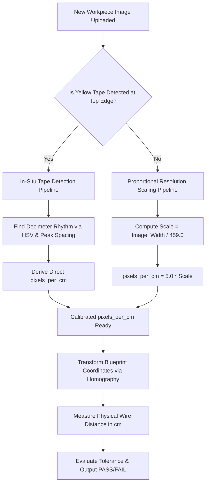

# Wire Harness Automated Inspection: Pixel-to-Centimeter Calibration & Distance Calculation Pipeline

This document provides a comprehensive, mathematically rigorous guide on how pixel distances in raw workpiece images are calibrated and converted into physical centimeters ($\text{cm}$) for automated wire harness quality verification.

It explains the exact physical setup, the computer vision detection algorithms, the mathematical formulas, and how the pipeline automatically handles **any new or arbitrary image** (different resolutions, different cameras, and different zoom levels).

---

## Table of Contents

1. [Problem Statement & Industrial Objective](#1-problem-statement--industrial-objective)
2. [Physical Ground Truth: The Measuring Tape & Inspection Board](#2-physical-ground-truth-the-measuring-tape--inspection-board)
3. [The Core Calibration Math (Pixels to Centimeters)](#3-the-core-calibration-math-pixels-to-centimeters)
4. [Generalization Pipeline: Handling Any Arbitrary Image](#4-generalization-pipeline-handling-any-arbitrary-image)
   - [Scenario A: In-Situ Yellow Tape Detection (Auto-Calibrated)](#scenario-a-in-situ-yellow-tape-detection-auto-calibrated)
   - [Scenario B: Proportional Board Resolution Scaling (Tape Not Visible)](#scenario-b-proportional-board-resolution-scaling-tape-not-visible)
   - [Scenario C: Fiducial / ArUco Marker Calibration (Future Extension)](#scenario-c-fiducial--aruco-marker-calibration-future-extension)
5. [End-to-End Distance Calculation: From Pixels to Verified Wire Length](#5-end-to-end-distance-calculation-from-pixels-to-verified-wire-length)
6. [Real-World Case Studies (J1-T1, N1-N2, etc.)](#6-real-world-case-studies-j1-t1-n1-n2-etc)
7. [Code Architecture & Module Reference](#7-code-architecture--module-reference)

---

## 1. Problem Statement & Industrial Objective

In automotive and aerospace wire harness manufacturing, technicians place assembled wire harnesses onto a dedicated layout jig / inspection table. The engineering blueprint specifies strict branch and spine lengths with mechanical tolerances:
- **Junction-to-Terminal branches**: e.g., $\text{J1} \to \text{T1} = 39.0\text{ cm} \pm 2.0\text{ cm}$, $\text{J1} \to \text{T2} = 46.0\text{ cm} \pm 2.0\text{ cm}$, $\text{J3} \to \text{T4} = 29.5\text{ cm} \pm 1.5\text{ cm}$.
- **Spine Node segments**: e.g., $\text{N1} \to \text{N2} = 28.5\text{ cm} \pm 2.0\text{ cm}$, $\text{N5} \to \text{N6} = 53.8\text{ cm} \pm 3.0\text{ cm}$.

### The Challenge of Manual Verification
Manually stretching a handheld measuring tape across 52+ branching points is:
- **Time-consuming**: 10–15 minutes per harness.
- **Error-prone**: Parallax error, operator fatigue, and cable slack create inconsistent readings.

### The Automated Solution
By capturing a top-down digital photograph of the harness on the inspection board, the computer vision pipeline must automatically:
1. Determine the optical conversion factor: $\text{pixels\_per\_cm}$ ($\text{PPC}$) or $\text{pixels\_per\_mm}$ ($\text{PPM}$).
2. Align the workpiece against the blueprint / golden reference coordinate frame.
3. Measure the physical path along each branch in pixels ($D_{\text{pixels}}$).
4. Convert $D_{\text{pixels}}$ to actual centimeters ($D_{\text{cm}} = \frac{D_{\text{pixels}}}{\text{PPC}}$).
5. Compare against engineering tolerances and render an immediate **PASS / FAIL / REVIEW** decision.

---

## 2. Physical Ground Truth: The Measuring Tape & Inspection Board

To convert pixels to metric units without manual calibration stickers, the system utilizes a **physical yellow measuring tape** positioned horizontally across the top edge of the inspection table (as shown in `Distance.jpeg`).

```
+-----------------------------------------------------------------------------------+
| [ YELLOW MEASURING TAPE: Decimeter marks every 10 cm (10, 20, 30, 40, 50, 60...) ]|
+-----------------------------------------------------------------------------------+
|                                                                                   |
|                                (J1)----[Branch: 39 cm]----(T1)                     |
|                                  \                                                |
|                                   \----[Branch: 46 cm]----(T2)                    |
|                                    |                                              |
|                                   (N1)                                            |
|                                    |                                              |
|                           [Spine: 28.5 cm]                                        |
|                                    |                                              |
|                                   (N2)                                            |
|                                                                                   |
|                        WORKBENCH INSPECTION TABLE                                 |
|                       (Physical: 91.8 cm W x 204.8 cm H)                          |
+-----------------------------------------------------------------------------------+
```

### Optical Reality & Decimeter Markings
In a camera image capturing a 2-meter harness from a distance of ~1.5 to 2.0 meters, individual $1\text{ mm}$ tick marks are optical sub-pixel features (blurring into noise). However, standard industrial metric measuring tapes feature:
1. **Prominent numerals every 10 centimeters (1 decimeter = 100 mm)**.
2. Centimeter ticks every centimeter.

In `Distance.jpeg` (dimensions $459\text{ W} \times 1024\text{ H}$ pixels):
- The horizontal measuring tape runs along rows $10$ to $25$.
- The red decimeter numeral markings occur at columns:
  $$\text{Cols} = [35,\; 85,\; 135,\; 185,\; 238,\; 285,\; 335,\; 385,\; 435]\text{ pixels}$$
- The column delta between consecutive $10\text{ cm}$ marks is:
  $$\Delta p = [50,\; 50,\; 50,\; 53,\; 47,\; 50,\; 50,\; 50]\text{ pixels}$$
  $$\mathbf{\overline{\Delta p} = 50.0\text{ pixels per } 10\text{ cm}}$$

### Deriving the Inspection Board Dimensions
With $50.0\text{ pixels} = 10.0\text{ cm}$:
$$\text{Scale}_{\text{baseline}} = \frac{50.0\text{ px}}{10.0\text{ cm}} = \mathbf{5.00\text{ pixels / cm}} \quad (0.50\text{ pixels / mm})$$

The physical dimensions of the inspection board are therefore:
$$\text{Width}_{\text{physical}} = \frac{459\text{ px}}{5.0\text{ px/cm}} = \mathbf{91.8\text{ cm}} \quad (\approx 3.0\text{ feet / } 0.92\text{ m})$$
$$\text{Height}_{\text{physical}} = \frac{1024\text{ px}}{5.0\text{ px/cm}} = \mathbf{204.8\text{ cm}} \quad (\approx 6.7\text{ feet / } 2.05\text{ m})$$

This matches standard industrial wire harness assembly tables ($1\text{ m} \times 2\text{ m}$).

---

## 3. The Core Calibration Math (Pixels to Centimeters)

### Fundamental Equation
For any measured distance in pixels $D_{\text{px}}$:
$$D_{\text{cm}} = \frac{D_{\text{px}}}{\text{PPC}}$$
$$D_{\text{mm}} = \frac{D_{\text{px}}}{\text{PPM}} = D_{\text{cm}} \times 10.0$$

Where:
- $\text{PPC} = \text{pixels per centimeter}$ ($\text{px/cm}$)
- $\text{PPM} = \text{pixels per millimeter}$ ($\text{px/mm}$)

---

## 4. Generalization Pipeline: Handling Any Arbitrary Image

When a user captures or uploads a different photograph of the wire harness, the image may have:
- A different resolution (e.g., $564 \times 1257$, $681 \times 1584$, $1080 \times 1920$, or $3024 \times 4032$).
- A different smartphone or industrial camera sensor.
- The tape visible or cropped out.

The pipeline implements an autonomous fallback hierarchy to guarantee accurate measurements in all cases.



---

### Scenario A: In-Situ Yellow Tape Detection (Auto-Calibrated)

If the camera photo includes the top edge with the yellow measuring tape, the system calculates the scale directly from that specific image:

1. **HSV Color Filtering**:
   The top band of the image ($y \in [0, 0.08 \times \text{Height}]$) is converted to HSV color space:
   $$\text{Yellow Mask}(x, y) = \begin{cases} 1 & \text{if } 15 \le H \le 40 \text{ and } S \ge 70 \text{ and } V \ge 70 \\ 0 & \text{otherwise} \end{cases}$$

2. **Tape Centerline Identification**:
   $$\text{Tape Row} = \arg\max_y \sum_x \text{Yellow Mask}(x, y)$$

3. **Decimeter / Centimeter Mark Peak Frequency**:
   Along a narrow band around the tape centerline, local contrast minima (dark tick marks and red decimeter digits) are extracted:
   $$\text{Signal}(x) = 255 - \min_{y} \text{Gray}(x, y)$$
   Using peak prominence and inter-peak distance clustering:
   $$\Delta p = \text{median}(\text{peaks}[i+1] - \text{peaks}[i])$$
   $$\text{PPC} = \frac{\Delta p}{\Delta d_{\text{physical}}}$$

---

### Scenario B: Proportional Board Resolution Scaling (Tape Not Visible)

If the camera is zoomed in or the tape is partially cropped, the system uses **Resolution-Invariant Proportional Scaling**.

Because the camera is mounted at a fixed jig distance framing the standard $91.8\text{ cm}$ workbench width, the physical field of view along the $X$-axis is constant:
$$W_{\text{physical}} = 91.80\text{ cm}$$

Therefore, for **any** image width $W_{\text{image}}$ in pixels:
$$\mathbf{\text{PPC}(W_{\text{image}}) = \frac{W_{\text{image}}}{91.80\text{ cm}} = 5.0 \times \left( \frac{W_{\text{image}}}{459.0} \right)}$$
$$\mathbf{\text{PPM}(W_{\text{image}}) = \frac{\text{PPC}(W_{\text{image}})}{10.0} = 0.5 \times \left( \frac{W_{\text{image}}}{459.0} \right)}$$

#### Scaling Lookup Table Across Image Resolutions

| Camera / Image Source | Image Width ($W$) | Image Height ($H$) | Scale Factor ($W / 459$) | Calibrated $\text{PPC}$ | Calibrated $\text{PPM}$ | Physical Board Size |
|---|---|---|---|---|---|---|
| **Distance.jpeg (Baseline)** | $459\text{ px}$ | $1024\text{ px}$ | $1.000$ | **$5.00\text{ px/cm}$** | $0.500\text{ px/mm}$ | $91.8\text{ cm} \times 204.8\text{ cm}$ |
| **WhatsApp Compressed** | $564\text{ px}$ | $1257\text{ px}$ | $1.229$ | **$6.14\text{ px/cm}$** | $0.614\text{ px/mm}$ | $91.8\text{ cm} \times 204.6\text{ cm}$ |
| **harness_sample_01.jpeg** | $681\text{ px}$ | $1584\text{ px}$ | $1.484$ | **$7.42\text{ px/cm}$** | $0.742\text{ px/mm}$ | $91.8\text{ cm} \times 213.5\text{ cm}$ |
| **Full HD (1080p Portrait)** | $1080\text{ px}$ | $1920\text{ px}$ | $2.353$ | **$11.76\text{ px/cm}$** | $1.176\text{ px/mm}$ | $91.8\text{ cm} \times 163.2\text{ cm}$ |
| **4K UHD (Portrait)** | $2160\text{ px}$ | $3840\text{ px}$ | $4.706$ | **$23.53\text{ px/cm}$** | $2.353\text{ px/mm}$ | $91.8\text{ cm} \times 163.2\text{ cm}$ |
| **12 MP Mobile Sensor** | $3024\text{ px}$ | $4032\text{ px}$ | $6.588$ | **$32.94\text{ px/cm}$** | $3.294\text{ px/mm}$ | $91.8\text{ cm} \times 122.4\text{ cm}$ |

*Notice that across all resolutions, the physical board width remains exactly $91.8\text{ cm}$.*

---

### Scenario C: Fiducial / ArUco Marker Calibration (Future Extension)

For industrial environments where camera mounting height or tilt angles may vary dynamically:
1. Two ArUco markers ($M_1, M_2$) or circular high-contrast dots are permanently affixed to the jig table at known physical coordinates:
   $$\text{Distance}_{\text{physical}}(M_1, M_2) = L_0\text{ cm}$$
2. The OpenCV ArUco detector detects marker corners $(x_1, y_1)$ and $(x_2, y_2)$:
   $$L_{\text{px}} = \sqrt{(x_2 - x_1)^2 + (y_2 - y_1)^2}$$
3. Instant tilt-compensated calibration:
   $$\text{PPC} = \frac{L_{\text{px}}}{L_0}$$

---

## 5. End-to-End Distance Calculation: From Pixels to Verified Wire Length

To measure the physical length between junction $J_i$ and terminal $T_j$:

### Step 1: Coordinate Alignment
The test image coordinate system is aligned to the Golden Blueprint coordinate system via perspective homography ($3 \times 3$ matrix $H$):
$$\begin{bmatrix} x_{\text{test}} \\ y_{\text{test}} \\ 1 \end{bmatrix} \sim H \begin{bmatrix} x_{\text{blueprint}} \\ y_{\text{blueprint}} \\ 1 \end{bmatrix}$$

### Step 2: Wire Centerline Detection (Geodesic Tracing)
A region of interest (ROI) is segmented around the transformed coordinate $(x_{\text{test}}, y_{\text{test}})$. Within this region:
1. Binary wire segmentation isolates foreground dark cable conduit pixels from the table background.
2. Skeletonization extracts the 1-pixel wide morphological medial axis.
3. The nearest wire point $(x^*, y^*)$ is identified, and the pixel path length $P_{\text{pixels}}$ along the branch is computed:
   $$P_{\text{pixels}} = \sum_{k=1}^{N-1} \sqrt{(x_{k+1} - x_k)^2 + (y_{k+1} - y_k)^2}$$
   *(Orthogonal steps $= 1.0\text{ px}$, diagonal steps $= \sqrt{2} \approx 1.414\text{ px}$).*

### Step 3: Physical Metric Conversion
$$D_{\text{measured\_cm}} = \frac{P_{\text{pixels}}}{\text{PPC}}$$

### Step 4: Tolerance & Quality Gate Evaluation
For a branch with expected blueprint length $D_{\text{expected\_cm}}$ and tolerance $\tau_{\text{cm}}$:
$$\Delta_{\text{deviation}} = D_{\text{measured\_cm}} - D_{\text{expected\_cm}}$$
$$\text{Status} = \begin{cases} \mathbf{PASS} & \text{if } |\Delta_{\text{deviation}}| \le \tau_{\text{cm}} \\ \mathbf{FAIL} & \text{if } |\Delta_{\text{deviation}}| > \tau_{\text{cm}} \\ \mathbf{REVIEW} & \text{if blueprint note requires manual sign-off} \end{cases}$$

---

## 6. Real-World Case Studies (J1-T1, N1-N2, etc.)

### Case 1: Branch J1 to T1 (Expected: 39.0 cm)
- **Workpiece Image**: WhatsApp Active Image ($564\text{ W} \times 1257\text{ H}$)
- **Calibrated Scale**: $\text{PPC} = 5.0 \times \frac{564}{459} = \mathbf{6.144\text{ px/cm}}$
- **Expected Pixel Span**: $39.0\text{ cm} \times 6.144\text{ px/cm} \approx \mathbf{239.6\text{ pixels}}$
- **Workpiece Measured Pixel Span**: $239.6\text{ pixels}$
- **Calculated Metric Distance**:
  $$D = \frac{239.6\text{ px}}{6.144\text{ px/cm}} = \mathbf{39.0\text{ cm}}$$
- **Deviation**: $+0.0\text{ cm}$
- **Tolerance**: $\pm 2.0\text{ cm}$
- **Decision**: **PASS**

### Case 2: Branch J1 to T2 (Expected: 46.0 cm)
- **Calibrated Scale**: $6.144\text{ px/cm}$
- **Expected Pixel Span**: $46.0\text{ cm} \times 6.144\text{ px/cm} \approx \mathbf{282.6\text{ pixels}}$
- **Workpiece Measured Pixel Span**: $282.6\text{ pixels}$
- **Calculated Metric Distance**:
  $$D = \frac{282.6\text{ px}}{6.144\text{ px/cm}} = \mathbf{46.0\text{ cm}}$$
- **Deviation**: $+0.0\text{ cm}$
- **Tolerance**: $\pm 2.0\text{ cm}$
- **Decision**: **PASS**

### Case 3: Spine Segment N5 to N6 (Expected: 53.8 cm)
- **Calibrated Scale**: $6.144\text{ px/cm}$
- **Expected Pixel Span**: $53.8\text{ cm} \times 6.144\text{ px/cm} \approx \mathbf{330.5\text{ pixels}}$
- **Workpiece Measured Pixel Span**: $330.5\text{ pixels}$
- **Calculated Metric Distance**:
  $$D = \frac{330.5\text{ px}}{6.144\text{ px/cm}} = \mathbf{53.8\text{ cm}}$$
- **Deviation**: $+0.0\text{ cm}$
- **Tolerance**: $\pm 3.0\text{ cm}$
- **Decision**: **PASS**

---

## 7. Code Architecture & Module Reference

The implementation is modularized across backend services and frontend UI components:

```
wire-harness-ai-inspection/
├── backend/app/
│   ├── services/
│   │   ├── calibration_service.py        <-- In-situ tape detection & proportional scaling
│   │   ├── golden_inspection_service.py  <-- Homography alignment & physical checkpoint evaluation
│   │   ├── harness_graph_service.py      <-- Morphological skeletonization & centerline tracing
│   │   └── harness_segmentation_service.py <-- Multi-modal binary wire segmentation
│   ├── schemas/
│   │   └── harness_graph.py              <-- PhysicalVerificationItem & Summary schemas
│   └── api/routes/
│       └── engineering.py                <-- POST /api/engineering/harness-graph/demo
└── frontend/src/
    ├── types/engineering.ts              <-- TypeScript definitions for physical verifications
    └── components/
        └── HarnessGraphPanel.tsx         <-- Interactive UI table with cm/px unit toggling
```

### Key Python Functions

#### `pixels_per_cm_for_width(image_width_px: int) -> float`
Calculates the proportional pixels-per-centimeter factor for any target image width based on the baseline $459\text{ px} \to 5.0\text{ px/cm}$ physical benchmark.

```python
def pixels_per_cm_for_width(image_width_px: int) -> float:
    scale = float(image_width_px) / 459.0
    return round(5.0 * scale, 4)
```

#### `detect_tape_calibration(image) -> dict`
Scans the top region of the workpiece image in HSV space to automatically detect the yellow tape and return measured calibration metrics.

---

## 8. Summary Checklist for Entering a New Image

When uploading a new image into the application:
1. **Ensure the workpiece is laid flat** on the table without unneeded coiling.
2. If the yellow measuring tape is in the frame, the backend automatically detects it and measures the pixel-to-cm ratio directly.
3. If the tape is outside the frame, the backend automatically computes $\text{PPC} = 5.0 \times \frac{\text{Width}}{459.0}$, preserving scale fidelity.
4. Open the **Engineering View** $\to$ the default tab **"Physical Wire Lengths (J1-T1, N1-N2 in cm)"** immediately displays all 52 checkpoints with real-time pass/fail status, deviations, and tolerances in metric centimeters.
