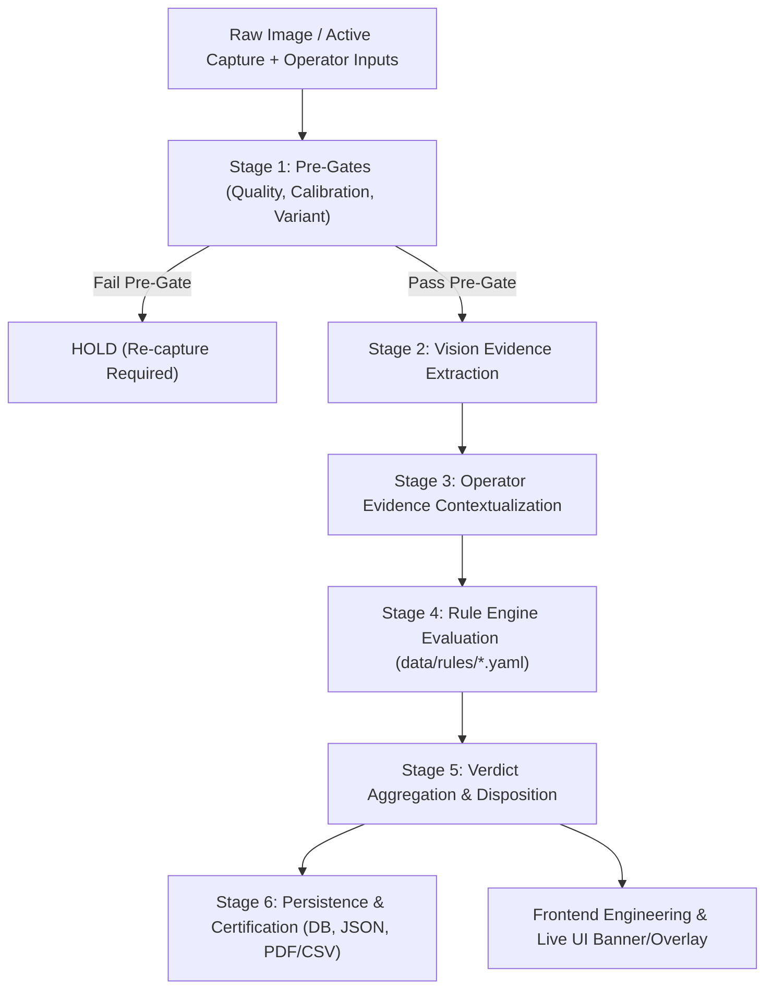

# Rule-Based Quality & Inspection Engine Design Document
## Customer: MSIL | W/H Part: YH200502 | Engine Harness: YHB

---

## 1. Executive Summary & Philosophy

This document defines the architectural specification for the deterministic, explainable, rule-based **ACCEPT / REJECT / HOLD** engine for final inspection of automotive wire harnesses (Customer: Maruti Suzuki India Limited - MSIL, Part Number: YH200502, Engine Harness: YHB).

### Core Directives
1. **No ML for Verdicts**: All final acceptance, rejection, and quarantine decisions are governed strictly by deterministic engineering rules derived from official factory quality standards (MSIL Tolerance Table, Branch Taping Standard BT45-02, Visual Inspection Standard WI/PR/79 rev 08, Final Assembly Check Sheet FRM/PR/19 rev 10, and Past Trouble Database PTDB YH200502).
2. **Reuse Existing Modules**: Exploit existing, robust OpenCV-based algorithms (`HarnessSegmentationService`, `HarnessGraphService`, `CalibrationService`, `WireColorIdentificationService`, `StickerInspectionService`, `FeatureExtractionService`) as evidence extractors without rewriting working components.
3. **Data Integrity First**: Rules are only as credible as their underlying evidence. Fabricated approximations (e.g. baseline length + pixel displacement, fallback checkpoint counts, synthetic confidences) are eliminated in favor of real skeleton geodesic path lengths, single-source optical calibration, and validated operator attestations.
4. **Fail-Safe Disposition**: `ACCEPT` is never a default. Any failure of a `CRITICAL` or `MAJOR` rule or any zero-tolerance defect triggers `REJECT`. Any missing evidence or unconfirmed check on mandatory rules triggers `HOLD`.

---

## 2. End-to-End Pipeline Architecture

The inspection process executes in a deterministic six-stage sequential pipeline:



### Stage Breakdown:
- **Stage 1: Pre-Inspection Quality & Calibration Gate**:
  - Image Quality: Sharpness (Laplacian variance $\ge 100.0$), Brightness ($40 \le \mu \le 225$), Clipping (underexposed $< 5\%$, overexposed $< 5\%$).
  - Calibration: Single source of truth via `CalibrationService`. Presence of calibration scale (`pixels_per_mm > 0`), valid provenance (`tape_detected`, `width_scaled`, or `manual_calibration`), and homography alignment confidence ($\ge 0.85$).
  - Pre-gate failure immediately halts dimensional rules and flags the workpiece as **`HOLD`** with specific re-capture guidance.
- **Stage 2: Vision Evidence Extraction**:
  - Segmentation: `HarnessSegmentationService` generates binary foreground mask.
  - Topology & Measurements: `HarnessGraphService` produces skeleton medial axis, nodes (junctions, terminals), branches, and calculates true geodesic pixel path lengths $P_{\text{pixels}}$ along the skeleton.
  - Calibration Conversion: Real physical length $L_{\text{mm}} = \frac{P_{\text{pixels}}}{\text{PPM}}$.
  - Color & Tape: `WireColorIdentificationService` verifies position marking tapes (green, dark blue, grey, black).
  - Sticker & OCR: `StickerInspectionService` extracts part number, serial number, batch, and barcode payload.
- **Stage 3: Operator Evidence Contextualization**:
  - Operator provides structured input from **FRM/PR/19** (associate ID, shift, date, total production qty, label serials used/scrapped, first/last piece inspection states).
  - Operator provides taping parameters per branch (measured cycle time in seconds, finished turn/lap count).
  - Pluggable adapters support future automated inputs (e.g. DSI electrical testing software, automated taping counters).
- **Stage 4: Rule Engine Execution**:
  - Declarative rule specifications loaded from validated YAML packs (`data/rules/*.yaml`).
  - Rules execute against the combined `InspectionContext`.
  - Missing evidence results in `NOT_EVALUATED` (never defaulted to `PASS`).
- **Stage 5: Aggregation & Final Disposition**:
  - Statuses: `PASS`, `FAIL`, `REVIEW`, `NOT_EVALUATED`, `WAIVED`.
  - Severities: `CRITICAL`, `MAJOR`, `MINOR`.
  - Final Verdict: `ACCEPT`, `REJECT`, or `HOLD`.
- **Stage 6: Persistence & Reporting**:
  - Database table `rule_verdicts` stores verdict, rule pack version, calibration provenance, image hash, full evaluation JSON.
  - Snapshot persisted to `data/inspection_results/{verdict_id}.json`.
  - PDF/CSV report generated with dedicated "Final Disposition & Reaction Plan" section.

---

## 3. Data Integrity & Calibration Fixes (Step 1)

### 3.1 Real Measured Branch Lengths vs. Fabricated Shifts
- **Current Defect**: `golden_inspection_service.py` computed `detected_mm = baseline_mm + (pixel_disp / ppm) * pos_sign`. This synthesizes measurements around blueprint baselines rather than measuring the actual harness cable.
- **Remediation**:
  1. Map each checkpoint to its corresponding topological branch in `HarnessGraphService` (junction $\to$ terminal or node $\to$ node).
  2. Measure the physical path length using the Dijkstra / medial axis skeleton path length in pixels divided by calibrated `pixels_per_mm`.
  3. If a branch cannot be resolved from the skeleton or endpoint matching fails, set `detected_mm = None`, `status = NOT_EVALUATED`, and flag for manual verification. A missing branch must never default to `PASS`.

### 3.2 Single Calibration Source of Truth & Provenance
- **Current Defect**: Conflicting default scales ($0.9160\text{ px/mm}$ in `golden_inspection_service`, $0.50\text{ px/mm}$ in `detailed.md`, $1.9608\text{ px/mm}$ in `golden_measurements.json`).
- **Remediation**:
  1. `CalibrationService` is the sole source of truth for all pixel-to-metric conversions.
  2. Every measurement carries calibration metadata:
     - `calibrated`: boolean flag.
     - `pixels_per_mm`: derived scale factor.
     - `provenance`: `"tape_detected"` | `"manual_calibration"` | `"width_scaled"`.
  3. If `calibrated == False` or `alignment_confidence < 0.85`, all dimensional rules are assigned `NOT_EVALUATED` and overall status is `HOLD`.

### 3.3 Elimination of Fabricated Fallbacks
- Remove `junction_count = ... or 31` and `node_count = ... or 12`.
- Remove graph-derived junctions and nodes unconditionally defaulting to `"status": "PASS"`.
- Remove hardcoded confidences ($0.95$, $0.96$). Confidences must reflect actual algorithm signal quality or be omitted if unmeasured.

### 3.4 Cleaning `golden_measurements.json` & Database Reconciliation
- **Deduplicate CP-T26..T35 Notes**: Replace the copy-paste `"J1 - T1 = 39 cm"` with actual junction-terminal relationships (e.g. `"J01 - T26"`, `"J01 - T27"`, etc.).
- **Flag Placeholder Checkpoints**: Checkpoints marked `"Manually placed checkpoint"` with default $150.0\text{ mm}$ (CP-T21, CP-T23, CP-T24, CP-T25, CP-T36) are assigned `status: "NEEDS_CONFIRMATION"`.
- **Add Missing Checkpoints**: Restore missing terminal definitions (T22, T33) and add standard spine node-to-node specifications (e.g. CP-N01-N02 through CP-N05-N06).
- **Sync JSON to DB**: Ensure SQLite `checkpoints` table is synchronized with `golden_measurements.json` as the authoritative source of truth.
- **Repair Stale Tests**: Update `tests/test_golden_system.py` to match the actual cleaned checkpoint inventory and reference image dimensions.

---

## 4. Rule Engine Architecture (`backend/app/services/rules/`)

```
backend/app/services/rules/
├── __init__.py
├── schemas.py              # Pydantic v2 schemas: RuleSpec, Evidence, RuleResult, HarnessVerdict, OperatorInput
├── registry.py             # Rule registry and handler dispatcher
├── loader.py               # YAML pack validator and loader
├── engine.py               # Core evaluation engine & pipeline coordinator
└── families/
    ├── __init__.py
    ├── gates.py            # Quality, calibration, variant gates
    ├── msil_tolerances.py  # MSIL dimensional tolerance chart + negative-side guard
    ├── taping.py           # BT45-02 branch taping standard (laps, time, ranks)
    ├── visual_wi79.py      # WI/PR/79 visual inspection against master sample
    ├── final_frm19.py      # FRM/PR/19 check-sheet 9x2 verification + reconciliation
    └── ptdb.py             # Past trouble database regression rules
```

### Declarative Rule Packs (`data/rules/*.yaml`):
1. `msil_tolerances.yaml`: Tolerance bands by nominal length ($\le 200$, $201-500$, $501-2000$, $2001-5000$, $>5000$) for trunk, branch, single wire, and clamp-to-clamp; negative-side guard threshold ($80\%$).
2. `taping_standard.yaml`: Branch types W, X, T, Y, V with lap limits, completion laps, time rank brackets ($S, A, B, C, D$), 23-24s rank gap threshold.
3. `visual_inspection_wi79.yaml`: Master sample validation, connector color matching, dummy seals, TBO, clamp count, labels, tape integrity.
4. `final_assembly_frm19.yaml`: 9 first/last checks, associate ID, E-code, shift, label reconciliation rules.
5. `ptdb_yh200502.yaml`: 23 historical MSIL concerns (coupler length, clamp distance/direction, grommet missing, routing, crimping).

---

## 5. Rule Families & Technical Specifications

### A. MSIL Dimensional Tolerance Chart (mm)
Classified by nominal dimension $L_{\text{nominal}}$ (inclusive bounds):

| Nominal Length ($L$) | Main Trunk | Branch Wire | Single Wire | Clamp-to-Clamp |
|---|---|---|---|---|
| $L \le 200\text{ mm}$ | $\pm 10$ | $+20 / -0$ | $+20 / -0$ | $\pm 5$ |
| $201 \le L \le 500\text{ mm}$ | $\pm 15$ | $+30 / -0$ | $+30 / -0$ | $\pm 5$ |
| $501 \le L \le 2000\text{ mm}$ | $\pm 20$ | $+40 / -0$ | $+40 / -0$ | $\pm 10$ |
| $2001 \le L \le 5000\text{ mm}$ | $\pm 25$ | $+50 / -0$ | $+50 / -0$ | $\pm 10$ |
| $L > 5000\text{ mm}$ | $\pm 75$ | N/A | N/A | N/A |

- **Asymmetry**: Branch wire and single wire have zero negative tolerance (negative length is defective).
- **Negative-Side Guard (WI/PR/79)**: Clamp-to-clamp dimensions falling on the negative side below $-80\%$ of tolerance (e.g. nominal $60 \pm 5 \implies [-4, -5]$ deviation) are flagged for **`REVIEW`** as process drift warning.

### B. Branch Taping Standard (BT45-02)
- **Lap Ranges per Branch Type**:
  - Type W: $26-30$ laps
  - Type X: $28-30$ laps (cross-taping permitted only on X)
  - Type T: $19-22$ laps
  - Type Y: $19-22$ laps
  - Type V: $19-22$ laps
  - Outside range $\implies$ Rank D $\implies$ **`FAIL`**.
- **Step / Completion Laps**: Step laps $7-8$, Completion $5-6$ laps; tape extension $30\text{ mm}$ from node toward main branch.
- **Time Ranks**: $S \le 22\text{s}$, $A: 25-30\text{s}$, $B: 31-35\text{s}$, $C: 36-40\text{s}$, $D \ge 41\text{s}$. Gap $23-24\text{s} \implies$ **`REVIEW`**. Minimum acceptable rank: $C$. Rank $D \implies$ **`FAIL`**.

### C. Visual Inspection WI/PR/79 rev 08
- Master sample comparison: part number, revision, connector colors, dummy seals present, TBO check, clamp count and locations, label presence and OCR readability.
- Items detectable via vision evaluate automatically; non-vision items (e.g. internal terminal latching) require operator sign-off with associate ID and timestamp.

### D. Final Assembly Check Sheet FRM/PR/19 rev 10
- 9 checks evaluated for First and Last piece of shift:
  1. Length as per drawing
  2. Correct part attachment
  3. No circuit wrong
  4. Correct colour VTB
  5. VTB punching as per drawing
  6. No excess taping
  7. Correct label attachment
  8. No loose taping
  9. No wrong terminal
- All $9 \times 2 = 18$ statuses must be `OK`. Any `NG` $\implies$ **`REJECT`**. Any `CORRECTED` $\implies$ **`REVIEW`** with supervisor note.
- Check-sheet part number must strictly match sticker OCR and selected variant.
- Label serial reconciliation: $(\text{Serial}_{\text{to}} - \text{Serial}_{\text{from}} + 1) - \text{Scrapped} == \text{Total Production Qty}$ (mismatch $\implies$ **`REVIEW`**).

### E. Past Trouble Database (PTDB YH200502) Regression Checks
23 historical MSIL concerns categorized and severity-weighted:
- Repeated / highlighted / vehicle-reported items are assigned **`CRITICAL`** severity.
- Specific checks include:
  - O2 sensor branch length (4P black)
  - EGR coupler branch length
  - CNG injector coupler branch length (2P blue)
  - Clamp distances near injector and crankshaft coupler
  - Clamp missing / wrong orientation (13 No. CNG controller, 24 No. backlight sensor)
  - Protector lock NG near ECM coupler
  - Coupler interchange: 4P grey air-cleaner vs 3P black MAF coupler
  - Injector interconnection branch routing
  - Taping miss: Alternator GND (grey), crank sensor coupler, rear O2 sensor height
  - Terminal-level crimping / TBO checks (attestation-backed).

---

## 6. Verdict Determination & Reaction Plan

### Disposition Matrix:
- **`REJECT`**:
  - Any rule with status `FAIL` and severity `CRITICAL` or `MAJOR`.
  - Any zero-tolerance defect ("defects not allowed at any location").
- **`HOLD`**:
  - Any mandatory rule evaluated as `NOT_EVALUATED` or `REVIEW`.
  - Image quality pre-gate failure or calibration missing/unaligned.
- **`ACCEPT`**:
  - ALL mandatory rules evaluated as `PASS`.
  - No `FAIL` or unreviewed `REVIEW` items.
  - Zero default acceptance.

### Mandatory Reaction Plan on REJECT or HOLD:
> **"Pink tag + Red tape, segregate, inform supervisor/line leader; no rework at visual-inspection stage; record NG details."**

---

## 7. Assumptions to Confirm with Factory

The following assumptions have been made based on standard automotive harness engineering practices and need formal confirmation with MSIL / YAZAKI plant quality engineering:

1. **Subject-to-Column Mapping in MSIL Tolerance Table**:
   - `Protector-Clip`, `Protector-Protector`, and `Clamp-Clamp` are mapped to the **Clamp-to-Clamp** column ($\pm 5$ to $\pm 10\text{ mm}$).
   - `Clip-Branch wire` and `Protector-Branch wire` are mapped to the **Main Trunk** column.
   - `Protector-End branch` is mapped to the **Branch Wire** column ($+20/-0$ to $+50/-0\text{ mm}$).
   - *Action*: Confirm with factory if any drawing-specific callouts override these column assignments.
2. **Negative-Side Guard Threshold**:
   - Set to $-80\%$ of clamp-to-clamp tolerance (e.g. deviation below $-4.0\text{ mm}$ on a $\pm 5.0\text{ mm}$ tolerance flags `REVIEW`).
   - *Action*: Confirm whether the factory requires strict rejection or review for values between $-4\text{ mm}$ and $-5\text{ mm}$.
3. **Branch Taping Gap (23s–24s)**:
   - BT45-02 specifies $S \le 22\text{s}$ and $A = 25-30\text{s}$. The $23-24\text{s}$ gap is treated as `REVIEW`.
   - *Action*: Confirm if $23-24\text{s}$ should be classified as Rank S or Rank A.
4. **DSI Software Integration Interface**:
   - DSI electrical continuity test integration is currently modeled via an extensible adapter schema (`OperatorInput.dsi_test_result`).
   - *Action*: Confirm wire harness electrical testing file format (CSV, JSON, TCP socket, or REST webhook) once DSI specification is released.
5. **Master Sample Validation Interval**:
   - WI/PR/79 master sample verification is assumed valid for the active work shift (8 hours).
   - *Action*: Confirm whether master sample check is shift-based, daily, or lot-based.
